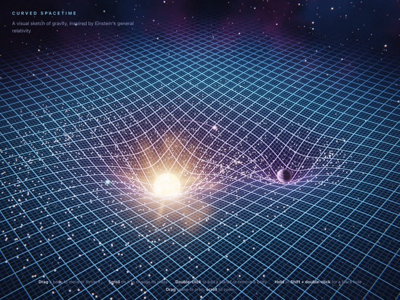
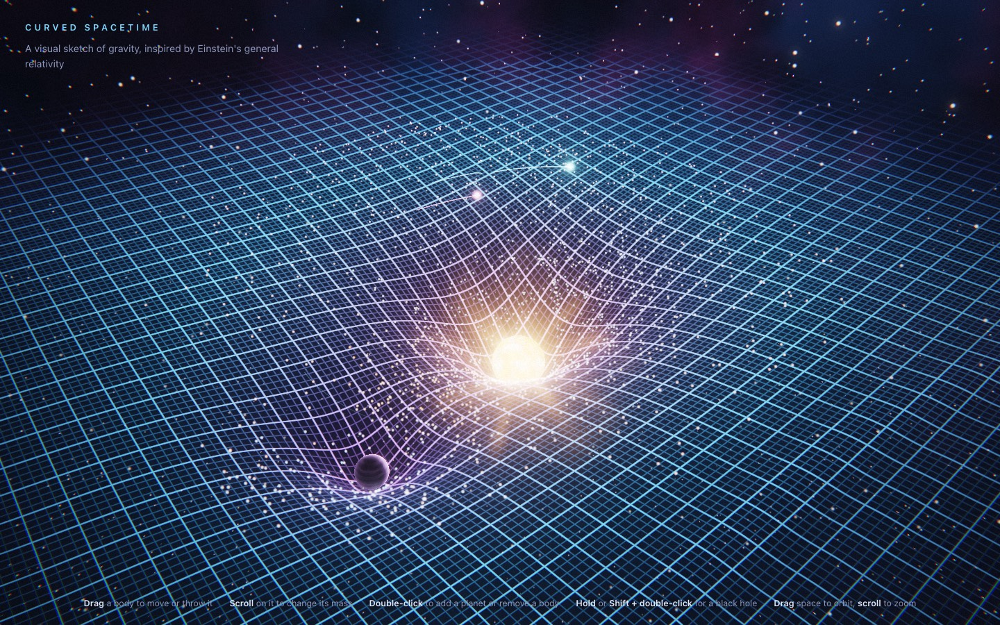
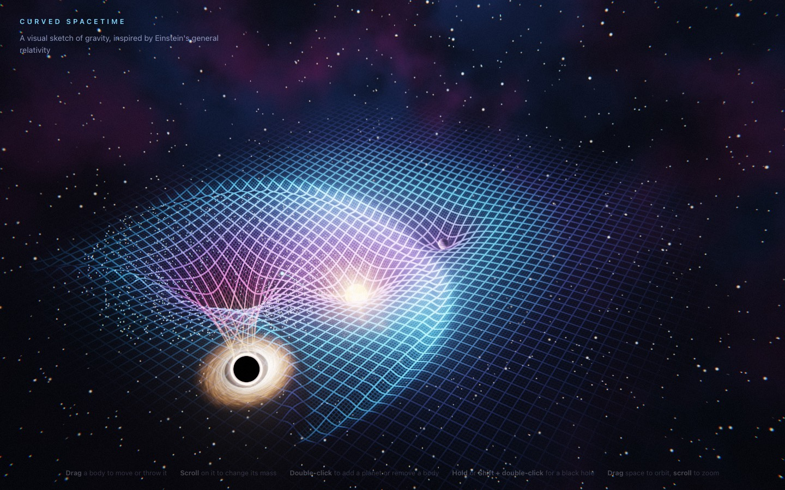
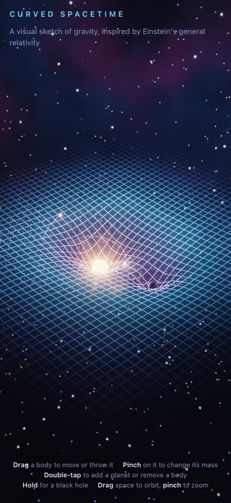

# Curved Spacetime (WebGL)

A rubber-sheet picture of gravity in raw WebGL 2: no libraries, no build step, no server.

Open `index.html` in a browser that supports WebGL 2.



## Screenshots

| Desktop | Black hole | Phone |
|---|---|---|
|  |  |  |

## What is on screen

- **The sheet**: a square 400 × 400 mesh that fades out toward its edges so it reads as endless.
  The fade is tuned to be nearly gone where the play area ends, so anywhere the grid shows, you
  can add or move a body. Its height, computed in the vertex shader, is the softened Newtonian
  potential of every body, drawn at one scale for every kind (so a black hole digs a deeper well
  than a star of the same mass), lifted by however far the edge of the play area has sunk, so flat
  space stays level however heavy the bodies get. Grid lines are drawn in the fragment shader with
  screen-space anti-aliasing and colored by depth, and stars light the grid around them. Being
  translucent, the sheet is drawn far to near in bands without writing depth, so its far side and
  the wells behind a slope stay visible from any angle. A depth-only pass follows, so dust, moons
  and trails behind a slope are still hidden.
- **Ripples**: a damped wave equation runs on a 192 × 192 grid on the CPU at a fixed 240 steps per
  second, so ripples move at about 28 units per second on any display, faster than stars and planets
  orbit. Anything orbiting close to a heavy black hole, and thrown bodies, can still outrun them. It is uploaded each frame as a half-float texture. Accelerating, thrown, merging or newly
  added bodies disturb it.
- **Bodies**: ray-traced spheres on camera-facing quads that write their own depth, so they cut
  cleanly into the sheet. Stars have animated plasma and a corona, planets are lit by the nearest
  star, black holes are black with a photon ring and an accretion disk. The disk starts at the innermost
  stable circular orbit, 3 horizon radii, and its brightness follows the Doppler and gravitational
  shift of each orbit, so the side coming toward the camera is much brighter.
- **Orbits**: the bodies pull on each other (N-body), and 1,800 dust grains and two moons with trails
  orbit in the same potential that shapes the sheet. Anything that falls into a body, or is flung
  too far from the heaviest one, comes back in a fresh orbit around it, so the disk never drains. A moon that hits a body falls in
  with a ripple, and its replacement fades in instead of popping up. Bodies that touch merge, conserving momentum and mass (up to the merged kind's cap);
  a black hole always wins. Two black holes radiate 5% of their mass as they merge, and that
  energy carries away its share of the momentum.
- **Lensing**: each black hole bends the finished frame with the point-lens equation, which warps the grid
  and stars behind it. Within the shadow radius, 2.6 horizon radii, the frame is black, and the
  photon ring glows just outside it. The mask also hides whatever passes in front of the hole,
  such as the near side of its disk.
- **Post-processing**: HDR render target with 4× MSAA, dual-filter bloom, ACES tone mapping,
  slight chromatic aberration, vignette and film grain. Falls back to 8-bit targets when the GPU
  cannot render to float textures.
- **Sky**: procedural stars and a nebula band, fixed in the world so they turn with the camera.

## How accurate is it

It is a picture of gravity, not a solution of Einstein's field equations. The motion is Newtonian
and the sheet is a teaching analogy. What holds and what does not:

| Element | Status |
|---|---|
| Orbits | Newtonian N-body with a softened potential. No relativistic precession, no innermost stable orbit for dust and moons, and gravity acts instantly. The softening makes eccentric orbits precess backward, where general relativity advances them. |
| The sheet | The rubber-sheet analogy. Height is the Newtonian potential, which matches the pull exactly, but in general relativity most of everyday gravity comes from time running slower near a mass, which a height field cannot show. It is not Flamm's paraboloid, the true embedding of space around a black hole. |
| Ripples | A scalar wave, set off by any jolt, at about 28 units per second, which the fastest bodies can outrun. Real gravitational waves are transverse, have two polarizations, start at the quadrupole order (orbiting pairs, mergers) and travel at the speed of light. |
| Black hole lensing | The weak-field point-lens equation, β = θ − θ_E²/θ, with a fixed Einstein radius of 2.04 horizon radii, chosen so the lensed horizon ends at the shadow edge. Foreground objects are lensed too. |
| Black hole shadow | Radius 2.6 horizon radii (√27 / 2), the Schwarzschild value. It is a screen mask, so it also hides whatever is in front of the hole. |
| Accretion disk | Inner edge at the innermost stable circular orbit (3 horizon radii), Keplerian spin, brightness scaled by g³ for the Doppler and gravitational shift of a circular orbit. |
| Mergers | The remnant moves with the center of mass. Black hole pairs lose 5% of their mass, and that energy carries off its share of the momentum. 5% fits near-equal pairs, such as the first detected merger, [GW150914](https://arxiv.org/abs/1602.03837), which radiated 3 of 65 solar masses; unequal pairs radiate less. |

Sources: Pössel, [Relatively complicated? Using models to teach general relativity at different
levels](https://arxiv.org/abs/1812.11589), sec. 4.2, on the rubber-sheet analogy; Carroll,
[Lecture Notes on General Relativity](https://arxiv.org/abs/gr-qc/9712019), eqs. 7.51 to 7.55 for
the photon sphere and innermost stable orbit and sec. 6 for gravitational waves; Perlick and
Tsupko, [Calculating black hole shadows: Review of analytical studies](https://arxiv.org/abs/2105.07101), eq. 8; Mao,
[Introduction to Gravitational Microlensing](https://arxiv.org/abs/0811.0441), sec. 3.

## Controls

Input runs on pointer events, so mouse, pen and touch share the same gestures. The hints at the
bottom switch between mouse and touch wording.

| Mouse | Touch | Effect |
|---|---|---|
| Drag a body | Drag a body | Move it; release while moving to throw it |
| Scroll over a body | Pinch on a body | Change its mass (up to 3 for a planet, 6 for a star, 10 for a black hole) |
| Double-click empty space | Double-tap empty space | Add a planet in orbit (up to 8 bodies) |
| Hold, or Shift + double-click | Hold | Add a black hole |
| Double-click a body | Double-tap a body | Remove it (one always stays) |
| Drag empty space | Drag empty space | Orbit the camera |
| Scroll elsewhere | Pinch elsewhere | Zoom |

The camera drifts slowly after a few seconds without input, unless the system asks for reduced
motion.

## Tests

The CPU math (potential and its match to gravity, circular orbits, merging, waves, matrices, ray picking on the
curved sheet, tap and double-tap detection) is tested with Node's built-in runner, no install needed:

```sh
node --test tests/math.test.mjs
```

Shaders and rendering are checked by eye; there is no automated visual test.
