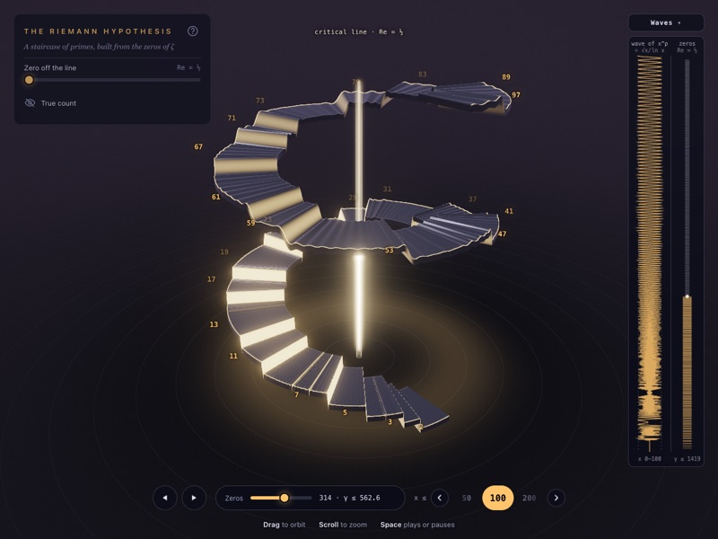

# The Riemann Hypothesis, Step by Step

A spiral staircase in raw WebGL 2 whose height at x is Riemann's explicit formula for π(x), the number
of primes up to x. With no zeros of ζ it is a smooth helical ramp. Each zero added ripples the ramp,
and with enough of them the ripples settle into one step per prime. The column in the middle is the
critical line, and a slider moves one zero off it, a what-if that shows the wave growth the Riemann Hypothesis rules out. No
libraries, no build step, no server.

Open `index.html` in a browser that supports WebGL 2.



The page explains what the hypothesis says and what the picture shows. It does not say whether the
hypothesis has been proved.

## What is on screen

- **The caption card**: the title, an italic serif subtitle, the "Zero off the line" slider
  and the "True count" eye toggle. It sits slightly faded and comes to full strength on hover or focus.
  The question-mark button beside the title opens a modal that starts with a short summary and then the longer explanation; it fades and
  rises in, and closes with the × at its top, its Close button, Escape or a click outside.
- **The staircase**: a ribbon from radius 4 to 7, turning once every 50 units of x, at height
  0.6 · π_N(x). It is dark polished stone with a gold line along its outer edge.
- **The light on the risers**: every surface glows in proportion to the slope of π_N(x). With few
  zeros the slope is spread along the ramp; as zeros are added it gathers into narrow spikes at the
  primes, so the light gathers onto the risers. Each riser's light is silver while its step is still
  blurred and turns gold once the step is resolved (the same sharpness rule as the labels, below).
- **The column**: the critical line, labeled "critical line · Re = ½" above its top. Each of the 1000
  zeros ½ + iγ sits on it at a height proportional to γ, dim until it is used. The newest zero flashes
  as it arrives; each one is dimmed as more are lit, so the stack stays a column of light.
- **Prime labels**: a prime's label fades in once its step is resolved. The step is measured as the
  rise of π_N within ±s of the prime, with s a quarter of the gap to the nearest neighboring prime,
  kept between 0.35 and 0.6, and it counts as resolved from a rise of about 0.6. At 2 the bare ramp
  starts at the cutoff τ and climbs at about 1/ln x, so the usual window would read it as a step (0.84)
  with no zeros; there the window is ±0.15 instead, where the bare ramp reads 0.36 and one zero already
  gives a full step. The same rule colors the risers. Brighter labels are
  placed first, with a head start for labels already on screen. A label stays fixed on its step; one that would
  overlap a label already placed (measured by their own widths) or the column's label fades out instead of
  moving.
  Once all 1000 zeros are in and nothing is playing, unresolved primes fade in faintly.
- **The resolution limit**: a label on the floor in front of the stairs, kept above the controls,
  reads "N zeros: every step sharp below x ≈ x_N" ("sharp below x ≈ x_N" on a narrow screen). x_N is
  the x where the fastest wave's period 2π x / γ_N equals half the mean prime gap, ½ ln x (83 for 100
  zeros, 747 for 1000). It is shown only while x_N falls inside the range. With 100 zeros on 0–200,
  every step below x_N passes the sharpness test and 8 of the 23 above it do.
- **The side panel** (the "Waves" button opens and closes it with a fade and a short slide; it starts
  closed on narrow screens):
  - the main wave of the newest zero, −2 Re li(x^ρ), divided by √x / ln x, with x running upward.
    On the line its height is about 2/|ρ| at every x (to within a relative 1/(|ρ| ln x)), shown by the two dashed guides: that steady width is
    what the hypothesis buys. The terms from x^(1/n), n ≥ 2, are left out of this view;
  - the limit x_N as a dashed line;
  - the 1000 ordinates γ, lit as they are used.
- **Zero off the line**: a slider moves the first zero to real part β between 0.5 and
  0.95. The functional equation together with conjugation mirrors every zero across the line
  (ρ ↦ 1 − ρ̄), so a partner at 1 − β comes with it, and the pair (β, 1 − β) replaces the zero at ½.
  The staircase gets the difference, wave(β) + wave(1 − β) − wave(½), and two rose points appear on
  either side of the column, inside the hollow of the spiral and hidden by any stairs in front of them.
  The panel shows that pair's wave in rose, scaled to fit, with the guides
  narrowing to keep the comparison: it keeps growing like x^(β − ½) after the division. That growth
  is what the hypothesis rules out: under it π(x) − li(x) = O(√x ln x), while a zero at β would give
  swings of about x^β / (|ρ| ln x). At β = 0.9 the staircase moves by more than two steps somewhere
  in 0–200. That is the mismatch between a made-up zero set and the real primes: with the true zeros
  the formula counts the primes exactly whether or not the hypothesis holds. All 1000 zeros in
  `zeros.js` are on the line. The explanation lives in the modal; nothing extra appears on screen.
- **True count**: an eye toggle, slashed and muted while off, gold while on, for a faint translucent band just outside the stairs at the exact height
  of π(x), off by default.
- **Playing**: forward adds zeros up to 1000 and backward takes them away down to 0, over 26 s each
  way with ln(1 + N) linear in time; each stops at its end and turns into pause while it runs. The
  clock waits while the formula is more than 4% (at least 3 zeros) behind it, so on a slow machine the
  count does not lag the clock. The slider only moves while paused; its position maps to N through a
  square root, so the low zeros get more of its travel. The camera drifts around the column after 3 s
  without input.
- **Reduced motion**: when the system asks for it, the page opens with all 1000 zeros, does not play
  or drift by itself and does not flash arriving zeros. Play and Space still work when pressed.
- **The range**: a reel of 25, 50, 100 and 200, each double the last, with arrows either side. The
  whole staircase is drawn from 0, so much past 200 it becomes a tower too thin to read. Changing the
  range grows or shrinks the stairs from the top, easing in ln x so doubling and halving take the same
  time, and the camera follows the height; with reduced motion it switches at once.
- **Framing**: the camera fits the stairs into the space left by the controls and, on a narrow
  screen, the caption card. On a wide screen the stairs stay centered under the controls, and the
  panel's width is kept free on both sides whether the panel is open or closed, so toggling it never
  moves the stairs; on a narrow screen the panel floats over the scene. Zoom runs from 0.35 to 1.4
  times the fitted distance.

## The formula

With Riemann's J(y) = Σ_{p^k ≤ y} 1/k, and μ the Möbius function,

π(x) = Σ_n μ(n)/n · J(x^(1/n)),
J(y) = li(y) − Σ_ρ li(y^ρ) − ln 2 + ∫_y^∞ dt / (t (t² − 1) ln t).

The sum over ρ runs over the nontrivial zeros in conjugate pairs, so each pair contributes
2 Re li(y^ρ) = 2 Re Ei(ρ ln y). The last integral carries the trivial zeros. Truncating the sum at N
pairs gives π_N(x), the height of the stairs.

J(y) is 0 for y < 2, so the outer sum is finite, and a term can be dropped below any cutoff τ in
(1, 2]. `math.js` uses τ = 1.6115743998, the root of li(τ) − ln 2 + ∫_τ^∞ = 0, so the zero-free ramp
is continuous.

| Piece | Method |
|---|---|
| Zeros | The first 1000 ordinates, from mpmath's `zetazero`, in `zeros.js`. |
| Grid | Uniform in ln x, with 8 samples per period of the fastest wave (γ₁₀₀₀ ≈ 1419.4). Built once over 0–200; changing the range only resamples it. |
| li(y) | The power series of Ei(ln y). |
| The integral | Σ_k E1(2k ln y), with E1 by its continued fraction. |
| Ei(ρ ln y), \|z\| ≥ 40 | The asymptotic series (e^z / z) Σ k!/z^k, cut where the terms drop below 1e−13. |
| Ei(ρ ln y), \|z\| < 40 | −E1(−z) + iπ, with E1 by Lentz's continued fraction. |
| Building up | Zeros are added a few per frame within a time budget. Every 10th partial sum is kept, so removing zeros restores a checkpoint and adds forward instead of subtracting. |

## How it is drawn

| Piece | Method |
|---|---|
| Heights | The formula is built once on a log-spaced grid over 0–200 (uniform in ln x, so a smaller range would get the same spacing) and resampled onto 4,096 evenly spaced samples in x, plus the off-line shift when β ≠ ½, and uploaded as an RG32F texture whenever the count or β changes. Green holds how resolved the nearest prime's step is. |
| Off-line shift | Sampled at 256 points evenly spaced in ln x (the wave is smooth in ln x) and interpolated; the on-line wave is cached per range. |
| Mesh | Fixed: tread, underside, outer wall, inner wall and an end cap, each vertex carrying its sample index. The vertex shader lifts it to its height; a radius uniform lets the same mesh draw the π(x) band. |
| Normals | Analytic, from the spiral's parametrization and the slope, not screen derivatives, so the thin triangles shade smoothly. |
| Floor and sky | Ray-cast per pixel in one full-screen pass: faint rings and a warm pool of light under the stairs. |
| Zeros, moved pair | Additive point sprites. |
| Glow | 4× MSAA, a six-level bloom, ACES tone mapping. |

The shimmer on the treads with many zeros is real: it is the Gibbs ripple of the truncated sum, made
visible by the lighting.

## Controls

| Mouse | Touch | Effect |
|---|---|---|
| Drag | Drag | Orbit |
| Scroll | Pinch | Zoom |
| Forward, backward or Space | Forward, backward | Add or remove zeros, or pause |
| Zeros slider | Zeros slider | Set N, while paused |
| Range reel | Same | Range of the staircase |
| Zero off the line | Same | Move the first zero to real part β |

A mouse click on a button gives focus back to the page, so Space keeps playing and pausing.

## Tests

```sh
node --test tests/*.test.mjs
```

They check the formula against the mpmath references, the play clock in both directions and
its wait, the range reel (each range double the last), the resolution limit, the sharpness rule (sharp at every prime above 3 with
1000 zeros, soft with none, every step sharp below x_N and most merged well above it), the
range easing, the narrower window at 2, the off-line pair (zero shift at ½, symmetric in β and 1 − β, a scaled wave of height about 2/|ρ| on the line
that keeps growing off it), label overlap, the mesh, the spiral, the resampling and the camera
framing and the zoom limits. Shaders and rendering are checked by eye.
